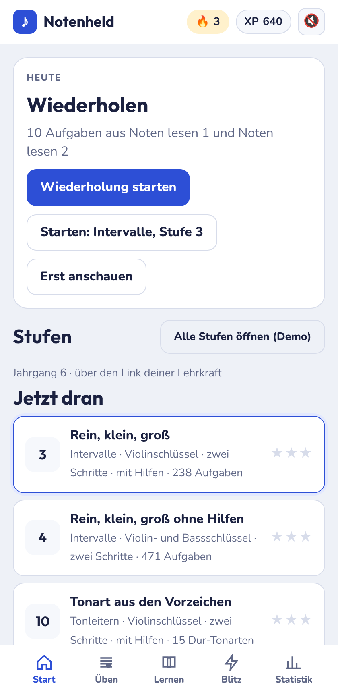
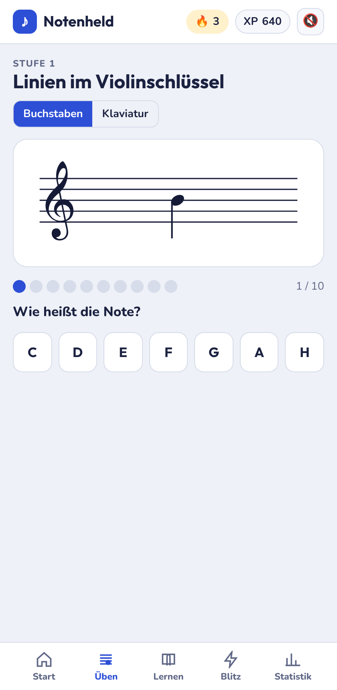
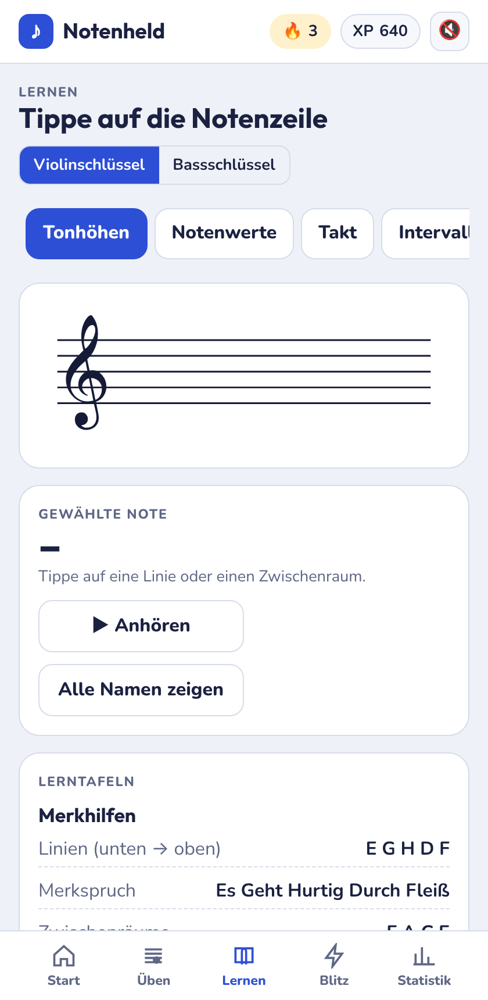
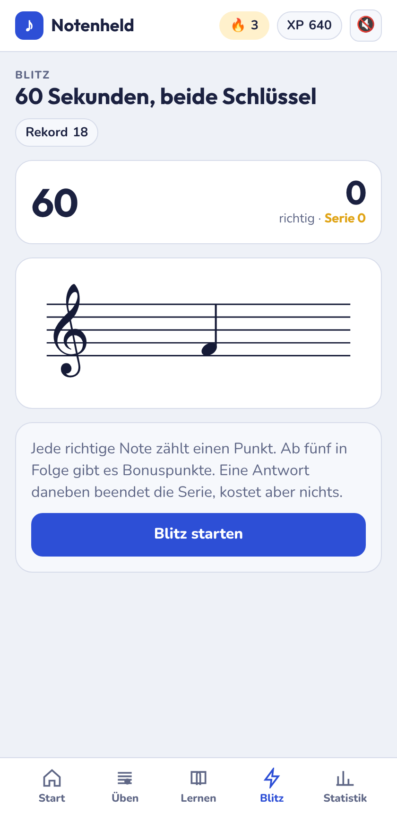
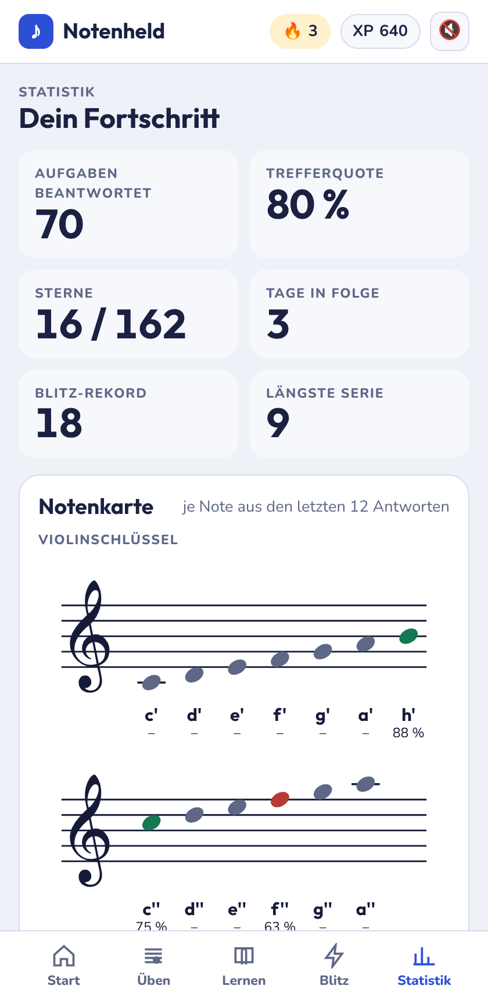

# Notenheld – klassische Notenlernapp

Noten lesen lernen im Violin- und Bassschlüssel, mit Notenwerten, Intervallen, Dur-Tonleitern und Dreiklängen, gedacht für Schülerinnen und Schüler am Gymnasium (Jahrgang 5 bis 13). Deutsche Notennamen (H, B, Fis, Es), Oktavschreibweise wie im Musikunterricht (c, c', c'').

Die App ist eine statische Web-App ohne Konto und ohne Tracking. Der Fortschritt wird nur im Browser des Geräts gespeichert.

Im Mittelpunkt steht das Wiederholen: Jede Stufe, die auf anderen aufbaut, nennt ihre Voraussetzungen und bietet „Grundlagen wiederholen“ an, und was du ohne Hilfen mit mindestens 8 von 10 geschafft hast, kommt nach 1, 3, 7, 14 und 30 Tagen in der Runde „Wiederholen“ wieder (Karte „Heute“ ganz oben auf der Startseite). Nichts Gelerntes wird je gesperrt.

## Starten

Die App besteht aus ES-Modulen. Browser laden Module nicht über `file://`, ein Doppelklick auf `index.html` zeigt deshalb nur eine leere Seite. Stattdessen einen kleinen Webserver im Projektordner starten:

```sh
npm run dev
```

oder ohne npm:

```sh
python3 -m http.server 8080
```

Dann http://localhost:8080 öffnen. Die Schriften liegen in `fonts/`, Internet ist dafür nicht nötig.

## Offline und Installation

Nach dem ersten Laden läuft Notenheld auch ohne Internet, zum Beispiel im Flugmodus. Ein Service Worker (`sw.js`) legt dafür alle Dateien der App in den Browser-Cache: HTML, CSS, JavaScript, Schriften, Icons und Manifest. Die Schriften (Noto Music, Outfit, Nunito) liegen selbst gehostet in `fonts/`, es wird nichts von Google Fonts nachgeladen.

Der Service Worker startet nur über `https` (GitHub Pages) oder auf dem eigenen Rechner (`localhost`, `127.0.0.1`).

Auf den Startbildschirm legen:

- **iPhone und iPad (Safari):** Teilen-Knopf → „Zum Home-Bildschirm“. Die App öffnet sich dann ohne Browserleiste.
- **Android (Chrome):** Menü ⋮ → „App installieren“ bzw. „Zum Startbildschirm hinzufügen“.
- **Computer (Chrome, Edge):** Symbol „Installieren“ rechts in der Adressleiste.

Für Entwicklerinnen und Entwickler:

- Die Cache-Version steht oben in `sw.js` (`const CACHE = "notenheld-v0.2.0-14"`). Bei jedem Release erhöhen, sonst behalten installierte Geräte die alten Dateien.
- Stand 26.11.2026: Live ist `main` 2f3dfe8 (Welle 10, Cache `notenheld-v0.2.0-13`).
- Welle 10 „Korrekturen aus der Prüfung“ (auf `main` 2f3dfe8): Warten nach „daneben“ und Teilerfolg, Auflösungszeichen, „Stellung“, Bauplan „1 1 ½ 1 1 1 ½“, „Grob- und Feinbestimmung“, sichtbare Freischalt-Regel, wählbare Merksprüche (Tab „Lernen“), Balken und Zählzeiten bei den Notenwerten, Fokus, Kontrast und Zeichen ✓/✗, bessere Lesbarkeit bei 320 px.
- Welle 11 „Wiederholen“ (Branch `wiederholen-11`, von `main` 2f3dfe8, Cache `notenheld-v0.2.0-14`, noch nicht auf `main`): Voraussetzungen je Stufe und „Grundlagen wiederholen“, Wiederholung über Tage (Karteikasten, Karte „Heute“, Runde „Wiederholen“), Jahrgang über den Lehrkraft-Link mit QR-Code, „Lernen“ mit Reitern, Intervalle vor Tonleitern, Notenwerte mit „Wie viele Schläge dauert diese Note? (1 Schlag = 1 Viertelnote)“.
- Neue Dateien unter `src/`, `css/`, `fonts/` oder `icons/` in die Liste `PRECACHE` in `sw.js` eintragen; `test/sw.test.js` vergleicht die Liste mit dem Dateibaum und schlägt sonst fehl.
- Vor einem Release bei laufendem Server `node docs/screens/ueberlauf.mjs` laufen lassen: Das Skript klickt bei 320 px und 420 px durch alle Stufen, Hilfen und Vorführungen und meldet jedes Element, das über seinen Rahmen hinausragt (braucht Playwright wie die Screenshots; keine Abhängigkeit der App).
- Beim Entwickeln hilft in Chrome DevTools unter Application → Service Workers „Update on reload“, damit Änderungen sofort sichtbar sind.
- Die Icons in `icons/` sind aus einem Bild im Aquarell-Stil erzeugt, das Sandra Störkel mit Apple Image Playground erstellt hat (KI-generiert) (Violinschlüssel auf Blau, Grün und Gelb). Beim maskierbaren Icon liegt der Schlüssel ganz im sicheren Kreis, der Rand ist mit den verwischten Farben des Bildes aufgefüllt. Nachweise: [THIRD_PARTY.md](THIRD_PARTY.md).

## Online-Version

Jeder Push auf `main` veröffentlicht die App über GitHub Pages (Workflow in `.github/workflows/pages.yml`). Dafür einmalig in den Repo-Einstellungen unter **Settings → Pages** als Source „GitHub Actions“ wählen.

## Für Lehrkräfte

Unter https://sandrastoerkel.github.io/notenlernapp/#lehrkraft erzeugen Sie einen Link und einen QR-Code für Ihre Klasse (erreichbar auch über den Textlink „Für Lehrkräfte“ am Ende der Statistik). Sie wählen den Jahrgang (5 bis 13), wahlweise „Musisches Gymnasium“, und je Paket, bis zu welcher Stufe es „dran“ ist; vorbelegt ist eine Voreinstellung nach dem LehrplanPLUS (Gymnasium Bayern, Musik). Den QR-Code können Sie für Tafel oder Beamer groß zeigen. Die Schülerinnen und Schüler öffnen den Link oder scannen den Code und bestätigen einmal. Danach ordnet die Startseite in „Jetzt dran“, „Schon dran gewesen“ und „Darüber hinaus“, und alles bis „dran“ ist sofort offen. Es wird nichts gesperrt, der Fortschritt bleibt. Ein zweiter Link samt QR-Code entfernt den Jahrgang wieder, ebenfalls nach einer Bestätigung. In der App selbst lässt sich der Jahrgang nicht ändern.

Datenschutz: Der Link enthält nur den Jahrgang und die Auswahl der Stufen, keine Namen und keine Ergebnisse. Der QR-Code entsteht im Gerät, ohne Netz; nichts verlässt das Gerät, und die Seite „Für Lehrkräfte“ ändert auf dem eigenen Gerät nichts. Der Link ist eine Adresse, kein Schloss: Wer ihn kennt, kann ihn öffnen, und wer die Seite „Für Lehrkräfte“ findet, kann sich auch selbst einen Link bauen. Ein echter Schutz ginge nur mit einem Server.

## Screenshots

Smartphone-Breite (420 px), helles Farbschema. Die dunklen Fassungen liegen daneben in `docs/screens/` (`*-dunkel.png`). Neu erzeugen mit `node docs/screens/screenshots.mjs` bei laufendem Server (braucht Playwright, siehe Kopf des Skripts; keine Abhängigkeit der App).

| Start | Üben | Lernen | Blitz | Statistik |
| ----- | ---- | ------ | ----- | --------- |
|  |  |  |  |  |

## Bereiche

| Bereich    | Inhalt                                                                                  |
| ---------- | --------------------------------------------------------------------------------------- |
| Start      | Karte „Heute“ (Wiederholung oder „Weiter üben“), Tagesserie, XP, Pakete und Stufen; mit Jahrgang „Jetzt dran“, „Schon dran gewesen“, „Darüber hinaus“ |
| Üben       | Zehn Aufgaben pro Runde, Eingabe über Buchstaben, Namen, Auswahlknöpfe oder Klaviatur, Ton, Sterne; „Dafür brauchst du: …“ und „Grundlagen wiederholen“ (6 Aufgaben); Runde „Wiederholen“ (10 Aufgaben aus bis zu drei Stufen) |
| Lernen     | Reiter je Inhalt (Tonhöhen, Notenwerte, Takt, Intervalle, Tonleitern, Dreiklänge), Notenzeile zum Antippen, Lerntafeln, Merksprüche (wählbar oder eigener Spruch) |
| Blitz      | 60 Sekunden, beide Schlüssel, Serienbonus, Rekord                                       |
| Statistik  | Schwache Stellen, Notenkarte, Sterne und Fach im Wiederholungskasten je Stufe, Jahrgang, Fortschritt zurücksetzen, Textlink „Für Lehrkräfte“ |

## Stufen

1. Violinschlüssel, Linien (E G H D F)
2. Violinschlüssel, Zwischenräume (F A C E)
3. Violinschlüssel mit Hilfslinien
4. Bassschlüssel, Linien (G H D F A)
5. Bassschlüssel, Zwischenräume (A C E G)
6. Bassschlüssel mit Hilfslinien
7. Vorzeichen ♯ und ♭
8. Alles gemischt

Das sind die Stufen von „Noten lesen“. Die Pakete stehen in dieser Reihenfolge (Startseite, „Lernen“, Statistik):

1. **Noten lesen** (8 Stufen, oben)
2. **Notenwerte und Pausen** (10 Stufen: Notenwerte, Pausen, Dauer in Schlägen, Punktierungen, Takt füllen; immer erst mit Hilfen – Merkmale, Notenwert-Pyramide, Zählleiste – dann ohne; drei Vorführungen als Lerntafeln)
3. **Intervalle** (10 Stufen: erst nur die Zahl, dann Grob- und Feinbestimmung – rein/klein/groß und vermindert/übermäßig in zwei Schritten, abwärts, bauen, Fehler finden; Stufe 1, 3, 5 und 8 mit aufklappbaren Hilfen: Klaviatur und Tabelle)
4. **Tonleitern** (13 Stufen: Ganz- und Halbtonschritte, welcher Ton fehlt, welcher Ton passt nicht, Vorzeichen, Tonart aus den Vorzeichen, parallele Molltonart; immer erst mit Hilfen – Klaviatur, Bauplan-Leiste bzw. Quintenzirkel – dann ohne; drei Vorführungen als Lerntafeln)
5. **Dreiklänge und Quintenzirkel** (6 Stufen)

Seit Welle 11 stehen die Intervalle vor den Tonleitern.

Eine Stufe öffnet sich, sobald in der vorherigen mindestens 8 von 10 Aufgaben richtig waren. Mit einem Jahrgang über den Link der Lehrkraft ist alles bis „dran“ sofort offen. Zum Ausprobieren gibt es auf der Startseite „Alle Stufen öffnen (Demo)“.

## Tastatur

`C` `D` `E` `F` `G` `A` `H` antworten sofort. Bei der Grobbestimmung (Paket „Intervalle“) wählen `1` bis `8` Prime bis Oktave. In Stufen mit Vorzeichen tippst du den ganzen Namen (`fis`, `es`, `b` …) und bestätigst mit `Enter`; `Backspace` löscht ein Zeichen, `Esc` leert die Eingabe. Auf dem Bildschirm stehen dort alle 21 Namen von C bis B in drei Reihen.

## Technik

- Reines HTML, CSS und JavaScript, keine Abhängigkeiten, kein Build.
- Der Code ist in ES-Module aufgeteilt: `src/music.js` (Notenmodell), `src/staff.js` (SVG-Zeichner), `src/store.js` (Fortschritt), `src/sprueche.js` (Merksprüche), `src/engine.js` (Rundenablauf, auch gemischte Runden), `src/repeat.js` (Wiederholung über Tage, Voraussetzungen), `src/klasse.js` (Jahrgang über den Lehrkraft-Link), `src/qr.js` (QR-Code, im Gerät erzeugt), `src/packs/` (Themenpakete), `src/views/` (die fünf Bereiche und die Seite „Für Lehrkräfte“), `src/app.js` (Verdrahtung). Styles in `css/style.css`. Details in [docs/ARCHITEKTUR.md](docs/ARCHITEKTUR.md).
- Tests mit dem eingebauten Test-Runner von Node: `npm test` (ohne npm: `node --test "test/**/*.test.js"`).
- Notenzeile, Noten und Klaviatur werden als SVG gezeichnet.
- Töne entstehen per Web Audio API (keine Audiodateien).
- Violinschlüssel aus der Schrift „Noto Music“ (selbst gehostet in `fonts/`), Bassschlüssel als Umriss aus „Bravura“ (OFL, `fonts/OFL-Bravura.txt`). Nachweise in [THIRD_PARTY.md](THIRD_PARTY.md).
- Fortschritt liegt in `localStorage` unter dem Schlüssel `notenheld.v2` (seit Welle 11 auch Karteikasten und Jahrgang, ohne neuen Schlüssel). Ältere Daten unter `notenheld.v1` werden beim ersten Start automatisch übernommen (der alte Eintrag bleibt unverändert liegen).

## Weiterarbeiten

- [docs/KONZEPT.md](docs/KONZEPT.md): Zielgruppe, Didaktik, Ausbau-Ideen
- [docs/ARCHITEKTUR.md](docs/ARCHITEKTUR.md): Zielstruktur in Modulen, Paket-Schnittstelle
- [docs/PLAN.md](docs/PLAN.md): Arbeitspakete und Wellen (zuletzt Welle 11 „Wiederholen“) mit Feinplan, Umsetzung und Prüfung
- `CLAUDE.md`: Regeln für Claude Code im Projekt
