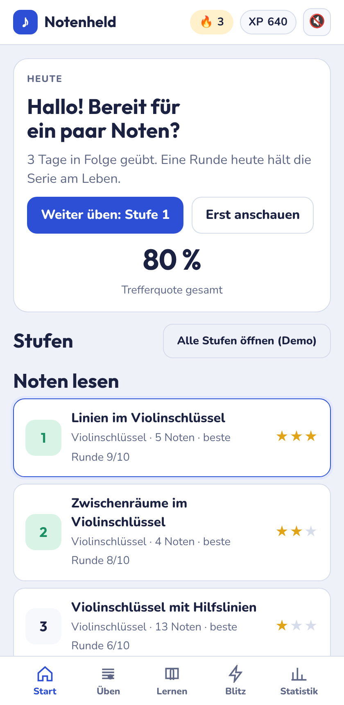
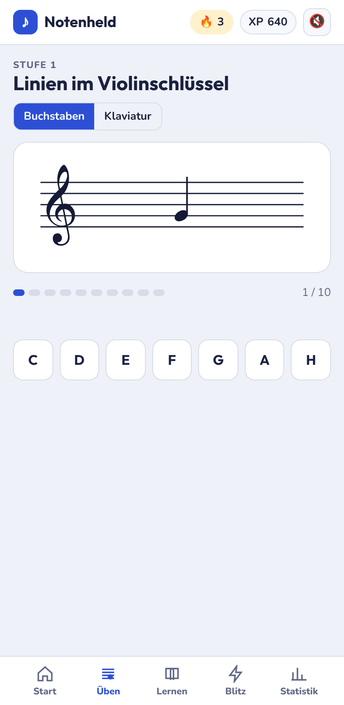
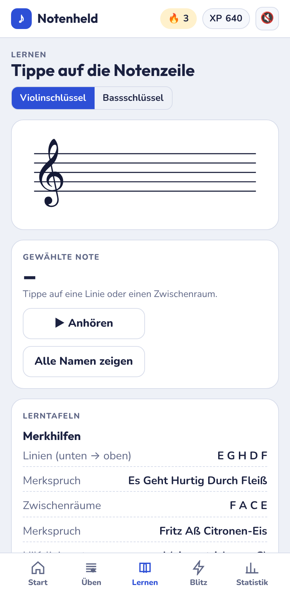
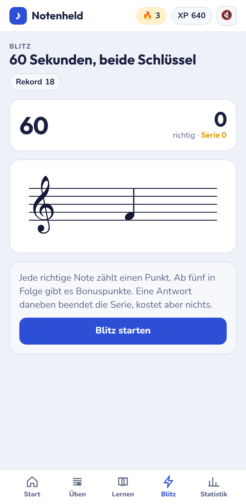
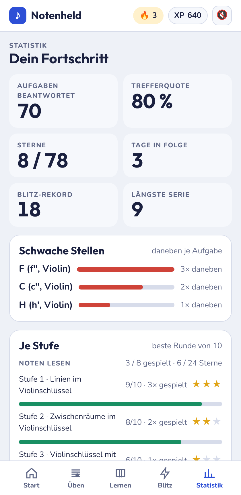

# Notenheld – klassische Notenlernapp

Noten lesen lernen im Violin- und Bassschlüssel, gedacht für Schülerinnen und Schüler am Gymnasium (Klasse 5 bis 12). Deutsche Notennamen (H, B, Fis, Es), Oktavschreibweise wie im Musikunterricht (c, c', c'').

Die App ist eine statische Web-App ohne Konto und ohne Tracking. Der Fortschritt wird nur im Browser des Geräts gespeichert.

## Starten

Die App besteht aus ES-Modulen. Browser laden Module nicht über `file://`, ein Doppelklick auf `index.html` zeigt deshalb nur eine leere Seite. Stattdessen einen kleinen Webserver im Projektordner starten:

```sh
npm run dev
```

oder ohne npm:

```sh
python3 -m http.server 8080
```

Dann http://localhost:8080 öffnen. Die Schriften liegen in `fonts/`, Internet ist dafür nicht nötig.

## Offline und Installation

Nach dem ersten Laden läuft Notenheld auch ohne Internet, zum Beispiel im Flugmodus. Ein Service Worker (`sw.js`) legt dafür alle Dateien der App in den Browser-Cache: HTML, CSS, JavaScript, Schriften, Icons und Manifest. Die Schriften (Noto Music, Outfit, Nunito) liegen selbst gehostet in `fonts/`, es wird nichts von Google Fonts nachgeladen.

Der Service Worker startet nur über `https` (GitHub Pages) oder auf dem eigenen Rechner (`localhost`, `127.0.0.1`).

Auf den Startbildschirm legen:

- **iPhone und iPad (Safari):** Teilen-Knopf → „Zum Home-Bildschirm“. Die App öffnet sich dann ohne Browserleiste.
- **Android (Chrome):** Menü ⋮ → „App installieren“ bzw. „Zum Startbildschirm hinzufügen“.
- **Computer (Chrome, Edge):** Symbol „Installieren“ rechts in der Adressleiste.

Für Entwicklerinnen und Entwickler:

- Die Cache-Version steht oben in `sw.js` (`const CACHE = "notenheld-v0.2.0-3"`). Bei jedem Release erhöhen, sonst behalten installierte Geräte die alten Dateien.
- Neue Dateien unter `src/`, `css/`, `fonts/` oder `icons/` in die Liste `PRECACHE` in `sw.js` eintragen; `test/sw.test.js` schlägt sonst fehl.
- Beim Entwickeln hilft in Chrome DevTools unter Application → Service Workers „Update on reload“, damit Änderungen sofort sichtbar sind.
- Die Icons in `icons/` sind aus einem eigenen Aquarell von Sandra Störkel erzeugt (Violinschlüssel auf Blau, Grün und Gelb). Beim maskierbaren Icon liegt der Schlüssel ganz im sicheren Kreis, der Rand ist mit den verwischten Farben des Bildes aufgefüllt. Nachweise: [THIRD_PARTY.md](THIRD_PARTY.md).

## Online-Version

Jeder Push auf `main` veröffentlicht die App über GitHub Pages (Workflow in `.github/workflows/pages.yml`). Dafür einmalig in den Repo-Einstellungen unter **Settings → Pages** als Source „GitHub Actions“ wählen.

## Screenshots

Smartphone-Breite (420 px), helles Farbschema. Die dunklen Fassungen liegen daneben in `docs/screens/` (`*-dunkel.png`). Neu erzeugen mit `node docs/screens/screenshots.mjs` bei laufendem Server (braucht Playwright, siehe Kopf des Skripts; keine Abhängigkeit der App).

| Start | Üben | Lernen | Blitz | Statistik |
| ----- | ---- | ------ | ----- | --------- |
|  |  |  |  |  |

## Bereiche

| Bereich    | Inhalt                                                                                  |
| ---------- | --------------------------------------------------------------------------------------- |
| Start      | Trefferquote, Tagesserie, XP, acht Stufen                                               |
| Üben       | Zehn Noten pro Runde, Eingabe über Buchstaben oder Klaviatur, Ton, Sterne               |
| Lernen     | Notenzeile zum Antippen, Merksprüche, alle Namen einblenden                             |
| Blitz      | 60 Sekunden, beide Schlüssel, Serienbonus, Rekord                                       |
| Statistik  | Schwache Stellen, Sterne je Stufe, Fortschritt zurücksetzen                             |

## Stufen

1. Violinschlüssel, Linien (E G H D F)
2. Violinschlüssel, Zwischenräume (F A C E)
3. Violinschlüssel mit Hilfslinien
4. Bassschlüssel, Linien (G H D F A)
5. Bassschlüssel, Zwischenräume (A C E G)
6. Bassschlüssel mit Hilfslinien
7. Vorzeichen ♯ und ♭
8. Alles gemischt

Eine Stufe öffnet sich, sobald in der vorherigen 8 von 10 Noten richtig waren. Zum Ausprobieren gibt es auf der Startseite „Alle Stufen öffnen (Demo)“.

## Tastatur

`C` `D` `E` `F` `G` `A` `H` antworten, `+` setzt ♯, `-` setzt ♭, `0` hebt das Vorzeichen auf.

## Technik

- Reines HTML, CSS und JavaScript, keine Abhängigkeiten, kein Build.
- Der Code ist in ES-Module aufgeteilt: `src/music.js` (Notenmodell), `src/staff.js` (SVG-Zeichner), `src/store.js` (Fortschritt), `src/engine.js` (Rundenablauf), `src/packs/` (Themenpakete), `src/views/` (die fünf Bereiche), `src/app.js` (Verdrahtung). Styles in `css/style.css`. Details in [docs/ARCHITEKTUR.md](docs/ARCHITEKTUR.md).
- Tests mit dem eingebauten Test-Runner von Node: `npm test` (ohne npm: `node --test "test/**/*.test.js"`).
- Notenzeile, Noten und Klaviatur werden als SVG gezeichnet.
- Töne entstehen per Web Audio API (keine Audiodateien).
- Schlüssel-Glyphen kommen aus der Schrift „Noto Music“, selbst gehostet in `fonts/` (Nachweise in [THIRD_PARTY.md](THIRD_PARTY.md)).
- Fortschritt liegt in `localStorage` unter dem Schlüssel `notenheld.v2`. Ältere Daten unter `notenheld.v1` werden beim ersten Start automatisch übernommen (der alte Eintrag bleibt unverändert liegen).

## Weiterarbeiten

- [docs/KONZEPT.md](docs/KONZEPT.md): Zielgruppe, Didaktik, Ausbau-Ideen
- [docs/ARCHITEKTUR.md](docs/ARCHITEKTUR.md): Zielstruktur in Modulen, Paket-Schnittstelle
- [docs/PLAN.md](docs/PLAN.md): Arbeitspakete A bis F mit fertigen Prompts für Claude Code
- `CLAUDE.md`: Regeln für Claude Code im Projekt
